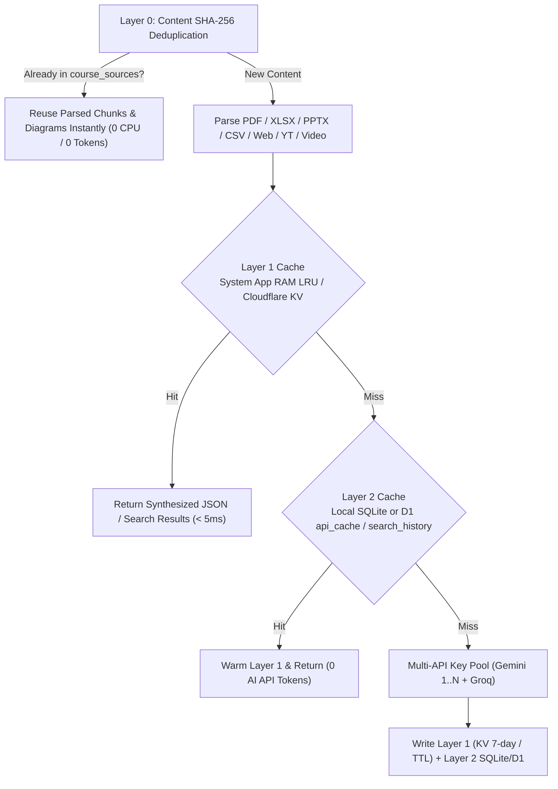

# 🗄️ Database, Storage & Caching Specification
# OmniLearn: Local SQLite (System App) + Cloudflare D1 / R2 / KV (Web Lite & Sync)

---

## 1. Hybrid Database & Storage Topology

OmniLearn uses a **dual-target SQLite + Object Storage schema** so the exact same normalized data model powers **both**:
1. **Downloaded Full System Application (Offline-First Local Machine)**: Unlimited local SQLite with **WAL concurrency** and **FTS5 Full-Text Search** across all ingested PDFs, Excel sheets, PowerPoints, TXT files, YouTube transcripts, websites, and video frames.
2. **Cloudflare Free Plan (`$0/month`) Web Portal**: Hosts the **Web Lite** preview, Admin Cloud Sync backup, Multi-API cache, and zero-egress R2 release binaries.

| Storage Layer | Downloaded System App (`~/.omnilearn/`) | Cloudflare Free Plan (Web Lite & Sync) | Free Tier Quotas (Cloudflare) |
|---|---|---|---|
| **Relational SQL** | `omnilearn_local.db` (SQLite 3 + `WAL` + `FTS5`) | **Cloudflare D1** (`omnilearn-db`) | **500 MB/DB**, **5 GB total**, **5M reads/day**, **100k writes/day** |
| **Document & Visual Assets** | `~/.omnilearn/assets/<course_id>/` (slides, PDF page PNGs, local docs) | **Cloudflare R2** (`SLIDES_BUCKET`) | **10 GB storage/mo**, **$0.00 Egress Fees** |
| **Installer Releases** | Receives auto-update manifest JSON | **Cloudflare R2** (`omnilearn-releases`) or **GitHub Releases** | Fits inside 10 GB R2 Free Tier / Free GitHub Releases (`$0` Egress) |
| **L1 Edge Cache** | In-memory LRU dict + SQLite `api_cache` | **Cloudflare Workers KV** (`APP_CACHE`) | **1 GB storage**, **100k reads/day**, **1k writes/day** |

---

## 2. Complete Cloudflare D1 Schema (`database/schema.sql`)

> **D1 Compatibility Rule**: Cloudflare D1 rejects `PRAGMA journal_mode = WAL;` and custom C extensions. Therefore `database/schema.sql` contains pure D1-compatible SQLite DDL across **14 tables**, while `database/local_schema.sql` imports it and appends local-only `PRAGMA WAL` + `FTS5` virtual tables.

```sql
-- ============================================================================
-- 1. ADMIN USERS TABLE (Single-Admin Authentication Lock)
-- ============================================================================
CREATE TABLE IF NOT EXISTS admin_users (
    id INTEGER PRIMARY KEY AUTOINCREMENT,
    username TEXT UNIQUE NOT NULL DEFAULT 'admin',
    password_hash TEXT NOT NULL,         -- PBKDF2-SHA256 (100k iterations)
    salt TEXT NOT NULL,                  -- 16-byte random hex salt
    created_at TEXT DEFAULT (datetime('now')),
    last_login TEXT
);

-- ============================================================================
-- 1B. GOOGLE GMAIL USERS (Normal Non-Admin Users Authenticated via Google OAuth)
-- ============================================================================
CREATE TABLE IF NOT EXISTS users (
    id TEXT PRIMARY KEY,
    google_sub TEXT UNIQUE NOT NULL,
    email TEXT UNIQUE NOT NULL,
    name TEXT DEFAULT '',
    picture TEXT DEFAULT '',
    role TEXT NOT NULL DEFAULT 'user',
    created_at TEXT DEFAULT (datetime('now')),
    last_login TEXT DEFAULT (datetime('now'))
);

-- ============================================================================
-- 2. ENCRYPTED MULTI-API KEY POOL (Zero-Leakage Load Balancing)
-- ============================================================================
CREATE TABLE IF NOT EXISTS api_keys (
    id TEXT PRIMARY KEY,
    owner_sub TEXT NOT NULL DEFAULT 'admin',
    is_default INTEGER NOT NULL DEFAULT 0,
    provider TEXT NOT NULL DEFAULT 'gemini', -- 'gemini', 'groq', 'openrouter'
    key_hash TEXT NOT NULL,                  -- SHA-256 hash for deduplication ONLY
    encrypted_key TEXT NOT NULL,             -- AES-256-GCM ciphertext (base64)
    iv TEXT NOT NULL,                        -- AES-256-GCM 96-bit IV (base64)
    status TEXT NOT NULL DEFAULT 'ACTIVE',   -- 'ACTIVE', 'COOLDOWN', 'INVALID'
    cooldown_until INTEGER DEFAULT 0,        -- Unix timestamp after HTTP 429
    request_count INTEGER DEFAULT 0,
    error_count INTEGER DEFAULT 0,
    last_used_at INTEGER DEFAULT 0,          -- Least-Used rotation pointer
    created_at TEXT DEFAULT (datetime('now'))
);

CREATE INDEX IF NOT EXISTS idx_api_keys_pool
    ON api_keys(provider, status, cooldown_until, last_used_at);

-- ============================================================================
-- 3. COURSES TABLE
-- ============================================================================
CREATE TABLE IF NOT EXISTS courses (
    id TEXT PRIMARY KEY,
    title TEXT NOT NULL,
    video_name TEXT DEFAULT '',              -- Primary label or mixed-source marker
    video_duration REAL DEFAULT 0.0,
    resolution TEXT DEFAULT 'MULTI_SOURCE',
    layout_type TEXT DEFAULT 'mixed',        -- '2x2', '1x2', '2x1', '1x1', 'mixed'
    source_count INTEGER DEFAULT 0,          -- Total attached sources across all types
    edition_origin TEXT DEFAULT 'system_app',-- 'system_app' or 'web_lite'
    status TEXT DEFAULT 'READY',
    progress INTEGER DEFAULT 100,
    current_stage TEXT DEFAULT 'Ready',
    created_at TEXT DEFAULT (datetime('now'))
);

CREATE INDEX IF NOT EXISTS idx_courses_created ON courses(created_at DESC);

-- ============================================================================
-- 4. WINDOW ROIS TABLE (For Multi-Window Lecture Videos)
-- ============================================================================
CREATE TABLE IF NOT EXISTS window_rois (
    id TEXT PRIMARY KEY,
    course_id TEXT NOT NULL,
    roi_key TEXT NOT NULL,
    name TEXT NOT NULL,
    ymin INTEGER NOT NULL,
    ymax INTEGER NOT NULL,
    xmin INTEGER NOT NULL,
    xmax INTEGER NOT NULL,
    color TEXT DEFAULT '#3B82F6',
    FOREIGN KEY(course_id) REFERENCES courses(id) ON DELETE CASCADE
);

CREATE INDEX IF NOT EXISTS idx_rois_course ON window_rois(course_id);

-- ============================================================================
-- 5. SUBJECTS TABLE
-- ============================================================================
CREATE TABLE IF NOT EXISTS subjects (
    id TEXT PRIMARY KEY,
    course_id TEXT NOT NULL,
    quadrant_key TEXT NOT NULL,
    title TEXT NOT NULL,
    short_title TEXT,
    topic TEXT,
    unit TEXT,
    instructor TEXT,
    badge_color TEXT DEFAULT '#3B82F6',
    summary TEXT,
    subtitles_transcript TEXT DEFAULT '[]',
    slide_crops TEXT DEFAULT '[]',           -- Visual slide/PDF-page URLs
    source_citations TEXT DEFAULT '[]',      -- References to course_sources IDs & pages
    mermaid_diagram TEXT DEFAULT '',
    FOREIGN KEY(course_id) REFERENCES courses(id) ON DELETE CASCADE
);

CREATE INDEX IF NOT EXISTS idx_subjects_course ON subjects(course_id);

-- ============================================================================
-- 6. SUBJECT DETAILS (Concepts & KaTeX Formulas)
-- ============================================================================
CREATE TABLE IF NOT EXISTS subject_details (
    subject_id TEXT PRIMARY KEY,
    key_concepts TEXT NOT NULL DEFAULT '[]',
    math_formulas TEXT NOT NULL DEFAULT '[]',
    FOREIGN KEY(subject_id) REFERENCES subjects(id) ON DELETE CASCADE
);

-- ============================================================================
-- 7. ADAPTIVE STUDY PLANS
-- ============================================================================
CREATE TABLE IF NOT EXISTS study_plans (
    subject_id TEXT PRIMARY KEY,
    target_days INTEGER DEFAULT 14,
    daily_hours REAL DEFAULT 3.0,
    schedule_json TEXT NOT NULL DEFAULT '[]',
    FOREIGN KEY(subject_id) REFERENCES subjects(id) ON DELETE CASCADE
);

-- ============================================================================
-- 8. ACTIVE RECALL QUIZZES
-- ============================================================================
CREATE TABLE IF NOT EXISTS quizzes (
    subject_id TEXT PRIMARY KEY,
    questions_json TEXT NOT NULL DEFAULT '[]',
    FOREIGN KEY(subject_id) REFERENCES subjects(id) ON DELETE CASCADE
);

-- ============================================================================
-- 9. UNIVERSITY MODEL EXAM PAPERS
-- ============================================================================
CREATE TABLE IF NOT EXISTS model_papers (
    subject_id TEXT PRIMARY KEY,
    title TEXT NOT NULL,
    time_allowed TEXT DEFAULT '60 Minutes',
    max_marks INTEGER DEFAULT 25,
    questions_json TEXT NOT NULL DEFAULT '[]',
    FOREIGN KEY(subject_id) REFERENCES subjects(id) ON DELETE CASCADE
);

-- ============================================================================
-- 10. STUDENT PROGRESS & ANALYTICS
-- ============================================================================
CREATE TABLE IF NOT EXISTS user_progress (
    subject_id TEXT PRIMARY KEY,
    quiz_attempts INTEGER DEFAULT 0,
    last_quiz_score REAL DEFAULT 0.0,
    mastery_score REAL DEFAULT 0.0,
    completed_tasks TEXT DEFAULT '[]',
    weak_spots TEXT DEFAULT '[]',
    updated_at TEXT DEFAULT (datetime('now')),
    FOREIGN KEY(subject_id) REFERENCES subjects(id) ON DELETE CASCADE
);

-- ============================================================================
-- 11. TWO-TIER AI & SEARCH CACHE
-- ============================================================================
CREATE TABLE IF NOT EXISTS api_cache (
    prompt_hash TEXT PRIMARY KEY,
    endpoint TEXT NOT NULL,
    response_json TEXT NOT NULL,
    tokens_saved INTEGER DEFAULT 0,
    created_at TEXT DEFAULT (datetime('now'))
);

-- ============================================================================
-- 12. UNIFIED COURSE SOURCES (9 Input Types + Extracted Knowledge)
-- ============================================================================
CREATE TABLE IF NOT EXISTS course_sources (
    id TEXT PRIMARY KEY,
    course_id TEXT NOT NULL,
    source_type TEXT NOT NULL,
    -- Supported values: 'video', 'pdf', 'txt', 'xlsx', 'ppt', 'csv', 'web_url', 'web_pdf', 'youtube'
    title TEXT NOT NULL,
    origin_url TEXT DEFAULT '',              -- URL for web/web_pdf/youtube/search hits
    search_query TEXT DEFAULT '',            -- Query that discovered this source (if any)
    file_hash TEXT NOT NULL,                 -- SHA-256 content hash (deduplicates uploads)
    storage_key TEXT DEFAULT '',             -- Local asset dir or R2 key
    raw_text_excerpt TEXT DEFAULT '',        -- Clean extracted text (indexed by FTS5 locally)
    structured_chunks_json TEXT DEFAULT '[]',-- Pages/Sheets/Slides/Chapters with page numbers
    visual_assets_json TEXT DEFAULT '[]',    -- Array of extracted slide/diagram image URLs
    discovered_links_json TEXT DEFAULT '[]', -- For 'web_url': PDFs found on the scraped page
    metadata_json TEXT DEFAULT '{}',         -- e.g. page_count, sheet_names, yt_duration, author
    status TEXT NOT NULL DEFAULT 'PARSED',   -- 'PENDING', 'PARSING', 'PARSED', 'FAILED'
    created_at TEXT DEFAULT (datetime('now')),
    FOREIGN KEY(course_id) REFERENCES courses(id) ON DELETE CASCADE
);

CREATE INDEX IF NOT EXISTS idx_sources_course ON course_sources(course_id, source_type);
CREATE INDEX IF NOT EXISTS idx_sources_hash ON course_sources(course_id, file_hash);

-- ============================================================================
-- 13. IN-APP SOURCE SEARCH HISTORY & QUERY CACHE
-- ============================================================================
CREATE TABLE IF NOT EXISTS source_search_history (
    id TEXT PRIMARY KEY,
    query TEXT NOT NULL,
    provider_filter TEXT DEFAULT 'all',      -- 'all', 'web', 'academic_pdf', 'youtube'
    query_hash TEXT UNIQUE NOT NULL,
    results_json TEXT NOT NULL DEFAULT '[]',
    added_source_count INTEGER DEFAULT 0,
    created_at TEXT DEFAULT (datetime('now'))
);

-- ============================================================================
-- 14. SYSTEM APPLICATION INSTALLER RELEASES (Powers Download Showcase)
-- ============================================================================
CREATE TABLE IF NOT EXISTS app_releases (
    id TEXT PRIMARY KEY,
    version TEXT NOT NULL,                   -- e.g., '1.2.0'
    platform TEXT NOT NULL,                  -- 'windows', 'macos', 'linux', 'android'
    arch TEXT DEFAULT 'x64',                 -- 'x64', 'arm64', 'universal'
    filename TEXT NOT NULL,                  -- e.g., 'OmniLearn-Setup-1.2.0.exe'
    download_url TEXT NOT NULL,              -- R2 zero-egress URL or GitHub Release URL
    sha256 TEXT NOT NULL,
    size_bytes INTEGER NOT NULL,
    is_latest INTEGER DEFAULT 1,
    release_notes TEXT DEFAULT '',
    created_at TEXT DEFAULT (datetime('now'))
);
```

---

## 3. System App Local-Only SQLite Extensions (`database/local_schema.sql`)

When running inside the **Downloaded Desktop System App**, `local_db.py` runs `schema.sql` followed by local SQLite optimizations that make searching large PDFs, spreadsheets, and PPTX decks near-instantaneously fast:

```sql
PRAGMA journal_mode = WAL;
PRAGMA synchronous = NORMAL;
PRAGMA foreign_keys = ON;
PRAGMA temp_store = MEMORY;

-- Instant Local Full-Text Search (FTS5) across ALL ingested docs, web articles & YT transcripts
CREATE VIRTUAL TABLE IF NOT EXISTS sources_fts USING fts5(
    source_id UNINDEXED,
    course_id UNINDEXED,
    source_type UNINDEXED,
    title,
    raw_text_excerpt,
    tokenize = 'porter unicode61'
);

CREATE TRIGGER IF NOT EXISTS trg_sources_ai AFTER INSERT ON course_sources BEGIN
    INSERT INTO sources_fts(source_id, course_id, source_type, title, raw_text_excerpt)
    VALUES (new.id, new.course_id, new.source_type, new.title, new.raw_text_excerpt);
END;

CREATE TRIGGER IF NOT EXISTS trg_sources_ad AFTER DELETE ON course_sources BEGIN
    DELETE FROM sources_fts WHERE source_id = old.id;
END;
```

---

## 4. Multi-Tier Caching, Search Deduplication & Zero-Leak Security

### 4.1 Four-Layer Caching Architecture


1. **Content-Addressable File Deduplication (`file_hash`)**: Uploading or fetching the same `.pdf`, `.xlsx`, `.pptx`, or URL twice never re-runs OCR/parsing or wastes AI quota.
2. **In-App Search Query Caching (`source_search_history` + KV `srch:<hash>`)**: Caches web/academic/YouTube discovery results for 6 hours so paginating or revisiting the Sources tab is instantaneous and stays well inside free academic/web rate limits.
3. **Cross-Source AI Synthesis Cache (`syn:<hash>`)**: Deterministic SHA-256 fingerprint across `(course_id + sorted source file_hashes + selected topics)` reuses synthesized notes, quizzes, and rubrics unless new sources are added!
4. **R2 Release Assets (`omnilearn-releases`)**: Stores `.exe`, `.dmg`, `.AppImage`, and `.apk` installers once in Cloudflare R2 (Free 10 GB) so unlimited user downloads incur **$0.00 egress fees**.

### 4.2 Zero-Leak API Key Storage
- **Cloudflare D1 & Local SQLite**: Keys entered on Sign-In or inside the Multi-API Pool Manager are immediately encrypted using **AES-256-GCM** with a cryptographically random 96-bit `iv`.
- **Master Key Protection**: In Cloudflare Workers, `MASTER_SECRET` lives in isolated Worker Secrets (`wrangler secret put`); in the Desktop System App, the wrapping secret is derived from OS hardware/keychain entropy (`Windows DPAPI` / `macOS Keychain` / `Linux SecretService`) or the Admin PBKDF2 key—never hardcoded in source code.
- **Strict Non-Disclosure**: `GET /api/pool` and `POST /api/auth/login` return strictly `{ total_active_keys, max_slots, slots: [{ slot: 1, provider: "gemini", status: "ACTIVE", requests_served: 14 }] }`. **Zero characters (not even last 4 digits) ever cross into UI memory.**
