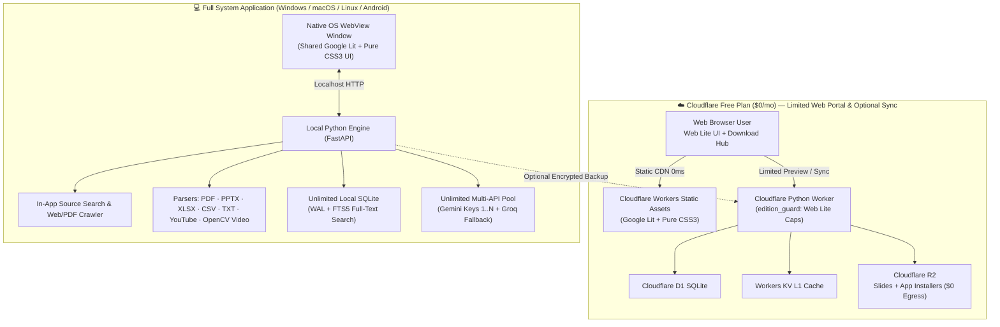
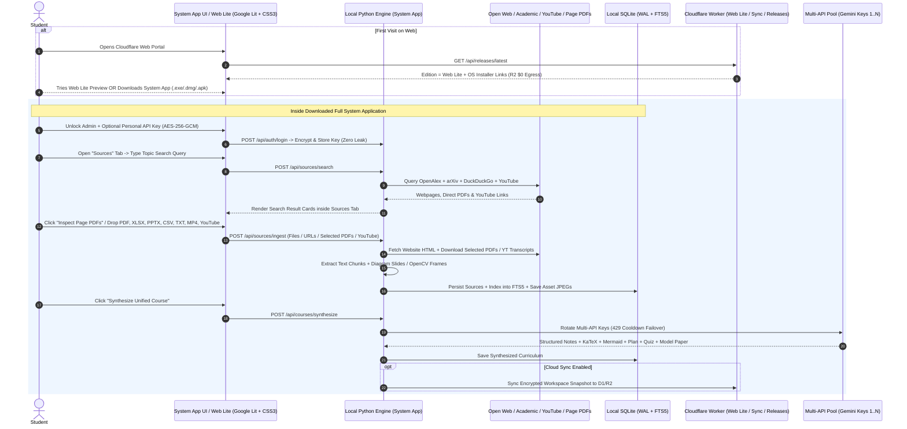

# 📄 Product Requirements Document (PRD)
# OmniLearn: Installable System Application + Cloudflare Free-Tier Web Lite & Multi-Source AI Study Engine

| Attribute | Details |
|---|---|
| **Product Name** | OmniLearn AI (Multi-Source Exam Mastery Engine) |
| **Distribution Model** | **Full Installable System Application** (Windows `.exe`, macOS `.dmg`, Linux `.AppImage`, Android `.apk`) + **Limited Web Lite Edition & Download Portal** |
| **Frontend Stack (Shared UI)** | **Google Lit (Web Components)** + Pure CSS3 (runs inside OS Native WebView on Desktop/Android & Cloudflare Edge on Web) |
| **Backend Engines** | **Local Python 3.13 + FastAPI + pywebview** (Full System App) paired with **Python on Cloudflare Workers** (`python_workers`, Web Lite & Sync API) |
| **Supported Learning Sources** | **9 Source Types**: Multi-Window Video, `.pdf`, `.txt`/`.md`, `.xlsx`, `.ppt`/`.pptx`, `.csv`, Web Links, Direct Website-Discovered PDFs, and YouTube Links |
| **Source Discovery** | **In-App Sources Search Tab**: Search Web, Open-Access Academic Papers & YouTube, inspect pages for PDF links, and add docs directly inside the app |
| **Database & Cache** | **Local SQLite (WAL + FTS5 Search)** in System App + **Cloudflare D1 SQLite & Workers KV** on Web/Sync |
| **Object & Release Storage** | **Local Encrypted Asset Store** + **Cloudflare R2** (10 GB Free, $0 Egress Fees for slides & app installers) |
| **AI Load Balancing** | **Multi-API Key Pool** (Round-Robin + 65s Cooldown Failover across Gemini & Groq Free Tiers — zero ML/DL training needed) |
| **Access Control** | Single-Admin Lock + **Zero-Leak** Sign-In Personal API Key Injection (AES-256-GCM) |
| **Cost** | **$0.00 / month** (Local compute + Free Open-Source Parsers + Cloudflare Free Plan + Free-Tier AI APIs) |

---

## 1. Executive Summary & Vision

### 1.1 The Real-World Problem
Students preparing for demanding exams don't learn from a single source format. They combine:
1. **Multi-Window Lecture Recordings** (e.g., 2x2 grids of 4 simultaneous subjects with subtitles and muted audio).
2. **Heterogeneous Course Files**: Lecture slide decks (`.ppt`/`.pptx`), thick textbooks & scanned handouts (`.pdf`), lab datasets & gradebooks (`.xlsx`/`.csv`), and markdown/text notes (`.txt`).
3. **Scattered Web & YouTube Resources**: Online tutorials, university portals hosting `.pdf` assignments inside webpages, and YouTube explanations—forcing students to constantly jump out to external browsers, download files manually, and fight single-API 15 RPM rate limits.
4. **Browser Sandbox & Cloud Limits**: Running heavy PDF rendering, PPTX/XLSX parsing, YouTube transcript/storyboard extraction, multi-GB OpenCV video slicing, and cross-origin webpage PDF scraping cannot execute reliably inside a constrained web browser or a 10 ms serverless edge worker.

### 1.2 The OmniLearn Hybrid Solution: Full System Application + Web Lite Portal
OmniLearn solves this with a **Local-First Native System Application** backed by an ultra-lightweight **Cloudflare Free-Plan Web Portal**:

1. **Full Installable System Application (Desktop & Android)**:
   - Wraps the **Google Lit + Pure CSS3** UI in a lightweight **Native OS WebView (`pywebview` on Windows/macOS/Linux; Capacitor System WebView `.apk` on Android)** powered directly by a local **Python Engine** (`backend/local_app/`).
   - Gives full unrestricted access to **local OS CPU/RAM, SQLite WAL + FTS5 full-text search, CORS-free In-App Web/Academic/YouTube Search, direct Website PDF harvesting, native parsers (`PDF`, `TXT`, `XLSX`, `PPT/PPTX`, `CSV`), OpenCV multi-window video slicing, Multi-API load balancing, and full export tools**.
2. **Limited Web Application Edition (Cloudflare Free Plan — $0/month)**:
   - Hosted globally at `https://omnilearn-exam-ai.<subdomain>.workers.dev` via **Cloudflare Workers Static Assets + Python Workers + D1 + R2 + KV**.
   - Serves as the **Official Download Hub** (zero-egress installers hosted on R2 / GitHub Releases) AND an interactive **Web Lite Edition** where users can test core workflows safely within strict Cloudflare free limits—with clear lock prompts (`🔒 Download System App to Unlock`) on heavy multi-source capabilities.

---

## 2. Edition Comparison Matrix (Web Lite vs. Full System App)

| Feature / Capability | 🌐 Web Application (`Web Lite` on Cloudflare) | 💻 System Application (Downloaded Desktop / Android) |
|---|---|---|
| **Runtime Architecture** | Browser + Cloudflare Python Worker (10 ms CPU, 128 MB RAM) | Native OS Window (`pywebview` / `.apk`) + Local Python Engine |
| **Database & Search** | Remote D1 / Temp Preview Only | **Local SQLite (`WAL + FTS5`)** on user's machine + Cloud Sync (Internet Required) |
| **In-App Source Search Tab** | Preview Only (3 OpenAlex abstracts max) | **Unlimited Search** (Web, Academic PDFs, Wikipedia, YouTube) + 1-Click Add |
| **Document Formats** | `.txt` / `.csv` up to 500 KB max; PDF/XLSX/PPT **Locked** | **Full Support**: `.pdf` (text + page visuals), `.txt`, `.xlsx`, `.ppt`/`.pptx`, `.csv` |
| **Web Links & Website PDFs** | Single static article preview; batch PDF crawler **Locked** | **Full Crawler**: Parses any webpage + extracts & downloads embedded `.pdf` links |
| **YouTube Link Learning** | **Locked** (`CORS` & bot-protection limits on edge) | **Unlocked**: Captions/Transcripts + Chapters + Keyframe Storyboard Visuals |
| **Multi-Window Lecture Video** | Max 5-min clip / 8 canvas slides (`1` subject sample) | **Unlimited Hours / 10–20 GB Videos**: Native C++ OpenCV 4-quadrant slicer |
| **Sources per Course** | Max **2 Sources** total | **Unlimited Mixed Sources** synthesized into one unified curriculum |
| **Multi-API Rotation Pool** | **1 API Key Slot** max | **Unlimited API Keys** (Gemini + Groq failover & 65s cooldown tracking) |
| **Study Aids & Exports** | Summary + 3 Sample MCQs + 1 Short Exam Q (Exports & AI Grader **Locked**) | **Full Notes (KaTeX + Mermaid), 14-Day Plan, 25+ MCQs, 3-Section Papers, AI Grader, Anki/MD/PDF Export** |

---

## 3. Core Architectural Pillars

### 3.1 Why Google Lit (Web Components) + Pure CSS3 (One UI Across Desktop, Android & Web)
| Google Framework | Why Chosen / Rejected |
|---|---|
| **Angular** | Heavy compile pipeline & large runtime overhead inside desktop/Android installers and Cloudflare assets. |
| **Closure Tools** | Legacy compiler toolchain; unsuitable for clean greenfield modular components. |
| **Flutter Web** | Renders onto `<canvas>` rather than HTML/CSS DOM (`use css` requirement), breaks native text selection/KaTeX/Mermaid DOM nodes, and duplicates mobile/web build logic. |
| **Google Lit (Web Components)** ✅ | **SELECTED**: Renders Light-DOM HTML5 styled strictly via external **Pure CSS3** stylesheets (`theme.css`, `layout.css`, `components.css`, `android.css`, `system-app.css`). Runs identically inside **Cloudflare Static Assets**, **Desktop `pywebview` (Edge WebView2/WKWebView)**, and **Android Capacitor System WebView** with zero build bloat. |

### 3.2 Unified 9-Source Learning & In-App Discovery Engine
Regardless of whether a student adds a textbook PDF, lecture PowerPoint, grading spreadsheet, 4-window silent video, YouTube lecture, or searches a webpage PDF directly inside the Sources Tab, every source is normalized into a standard **`NormalizedSourcePayload`**:
- `text_chunks`: Structured sections with page numbers / sheet names / timestamps.
- `visual_slides`: High-resolution JPEGs extracted from PDF diagram pages, PPTX embedded charts, YouTube storyboards, or video quadrants—stored locally or in R2 and linked directly inside **Visual Notes** and **Quizzes**.
- `source_citations`: Page/URL/timestamp attribution so AI notes explain *which* source contributed each concept!

### 3.3 Multi-API Key Rotation & Zero-Leak Sign-In Security
1. **Multi-API Key Pool (`api_pool.py`)**: Rotates requests via Least-Used / Round-Robin across multiple free-tier Gemini 2.0 Flash keys and Groq fallback keys; HTTP `429`/`503` puts the failing key into a 65-second cooldown and retries the next active key within the same request.
2. **Zero-Leak Sign-In Key Injection**:
   - Single-Admin authentication (`PBKDF2-SHA256` 100,000 iterations) gates all modifications in Admin Mode / System App.
   - Sign-In includes `"Add Personal API Key (Optional)"`—processed **only after** Admin password verification passes, encrypted via **AES-256-GCM** (Web Crypto in Cloudflare / OS Keychain + AES-GCM locally).
   - **Zero Character Exposure**: Neither Web Lite nor System App ever transmits or renders plaintext keys, prefixes, or suffixes—only anonymous slot health (`Slot #1 • GEMINI • ACTIVE • 14 calls`).

---

## 4. Functional Requirements (FR)

- **FR-1 (Hybrid Web Lite & System App Distribution)**: Cloudflare hosts the OS-aware **Download Center + Limited Web Lite** preview; heavy features prompt download of `.exe`/`.dmg`/`.AppImage`/`.apk` from Cloudflare R2 Releases (`$0` egress) or GitHub Releases.
- **FR-2 (In-App Source Search Tab)**: Built-in search bar querying OpenAlex, arXiv, Wikipedia, DuckDuckGo Lite/HTML, and YouTube Search inside the UI with instant preview and `[ + Add Source ]`.
- **FR-3 (Website & Direct PDF Harvesting)**: Pasting or searching a URL extracts clean web article text AND automatically discovers all downloadable `.pdf` documents linked on that webpage for selective 1-click import inside the app.
- **FR-4 (Universal File Parsers & 4-Quadrant Lecture Mode)**: Native local parsing for `.pdf` (text + page diagram renders), `.txt`/`.md`, `.xlsx` (sheets & tables), `.ppt`/`.pptx` (slides, speaker notes & embedded images), `.csv`, and multi-window video streams where **all 4 quadrants represent 4 distinct lectures of ONE target subject**, plus **unlimited subjects (`1..N`)** per course.
- **FR-5 (YouTube Source Ingestion)**: Accepts YouTube URLs, extracts video metadata, chapter timestamps, captions/transcripts, and keyframe thumbnails.
- **FR-6 (`.env` Single-Admin Lock & Zero-Leak Sign-In)**: Admin User ID (`OMNILEARN_ADMIN_USERNAME`), Master Password (`OMNILEARN_ADMIN_PASSWORD`), and Multi-API keys configured cleanly in `.env` or UI; strict User ID + PBKDF2 password verification with AES-256-GCM personal key storage and zero key character disclosure.
- **FR-7 (Multi-API Load Balancer — Internet Required)**: Least-used key rotation across unlimited keys (System App) or 1 slot (Web Lite) with 65s HTTP 429 cooldown failover. Active internet connectivity and a valid AI API key are strictly required (`400`/`503` without fallback).
- **FR-8 (Dual SQLite + Multi-Tier Caching)**: Local SQLite (`WAL + FTS5` full-text search across all sources) in System App; Cloudflare KV (L1) + D1 (L2) + R2 on Cloudflare.
- **FR-9 (Cross-Source Visual Notes, KaTeX & Mermaid)**: Synthesizes merged insights across mixed sources (e.g., Video + PDF + YouTube + XLSX) with embedded slide/diagram visuals, KaTeX math, Mermaid flowcharts, and source citations.
- **FR-10 (Study Plan, Quizzes, Model Papers & AI Grader)**: Spaced-repetition plan, Active Recall MCQs + Anki export, 3-section University Model Papers with AI Rubric Grader, and SVG Readiness Radar across Desktop & Android.

---

## 5. End-to-End Execution Flow

---

## 6. Step-by-Step Implementation Plan

1. **Step 1 — Unified Database Schemas (`database/`)**: Finalize `schema.sql` (Cloudflare D1-compatible 14 tables including `course_sources`, `source_search_history`, `app_releases`) and `local_schema.sql` (adds SQLite WAL + `sources_fts` full-text search index).
2. **Step 2 — Shared Frontend (`frontend/` with Google Lit + Pure CSS3)**: Build modular CSS (`theme.css`, `layout.css`, `components.css`, `android.css`, `system-app.css`), `edition-gate.js` + Download Showcase Banner, `<omnilearn-sources>` (In-App Search + 9-Source Dropzone + Website PDF Picker + YouTube Adder), and locked overlays for Web Lite.
3. **Step 3 — Local System App Backend (`backend/local_app/`)**: Implement Python 3.13 + FastAPI local API (`local_api.py`), Web/Academic/YouTube in-app search aggregator (`source_search.py`), unified document/web/YouTube/OpenCV parsers (`parsers/`), AES-256-GCM key pool, SSRF/path guards, and local SQLite persistence (`local_db.py`).
4. **Step 4 — Cloudflare Web Lite & Release Gateway (`backend/src/`)**: Implement Cloudflare Python Worker (`main.py`, `edition_guard.py`, `crypto_utils.py`, `auth.py`, `api_pool.py`, `cache.py`, `storage.py`, `gemini_client.py`) enforcing `web_lite` sandbox quotas and serving `/api/releases/latest`.
5. **Step 5 — Automated Security, Parser & Edition-Gate Tests (`tests/`)**: `pytest` suite covering all file parsers, SSRF IP blocking, zero-leak API key assertions, Web Lite `403` enforcement, and `wrangler dev --local` edge integration.
6. **Step 6 — Native Desktop & Android Packaging**: Bundle Desktop System App via **`pywebview` + PyInstaller** (`.exe` / `.dmg` / `.AppImage`) and Android `.apk` via **Capacitor** wrapping `frontend/`.
7. **Step 7 — Cloudflare Free Plan Deployment & Release Upload**: Provision D1/R2/KV + secrets via Wrangler CLI, upload installers to R2 (`omnilearn-releases`) or GitHub Releases, deploy Web Lite portal via `npx wrangler deploy`.
